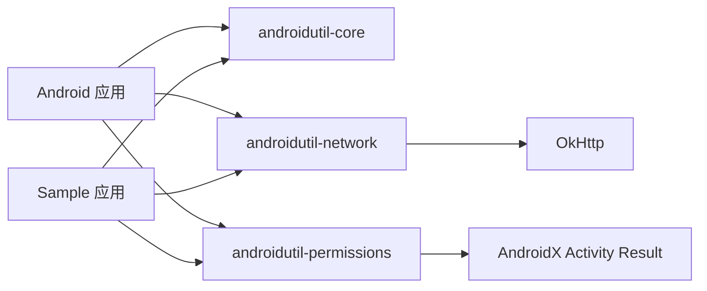

# 架构与边界

AndroidUtil 刻意做成模块化库。应用只应依赖真正用到的能力。

## 设计规则

1. 公开 API **Kotlin 优先**，同时保证 Java 可直接调用。
2. 模块之间默认互不依赖，除非能力本身需要。
3. UI 归属宿主应用；工具层不私自弹 Toast / Dialog。
4. Context 优先使用 Application Context，不做多余长生命周期持有。
5. 文件默认落在应用私有目录；受限硬件标识与隐藏 Android API 不在范围内。
6. 网络客户端可注入、请求可取消；诊断日志默认关闭且会脱敏。
7. 一项工具必须比「让用户直接引入专门库」更小、更清晰，否则不应进入本项目。

本项目会拒绝：图片加载器、支付封装、分析统计、依赖注入框架、大而全 UI 组件集。这些应由成熟第三方库或官方厂商 SDK 解决。

本地 `CrashHandler` 只做应用私有目录落盘与链式交接，**不**做成远程崩溃分析平台；需要云端聚合时请接入 Crashlytics / Sentry 等，并可与本库并存。

`core` 可持续收录**高频、默认可安全上架**的现代工具（剪贴板敏感标记、NetworkCapabilities、分区存储 Uri、通知渠道等），但不会为了「类数量」去复制整个 Android SDK。

各类型用法见 [README.md](../README.md)。
