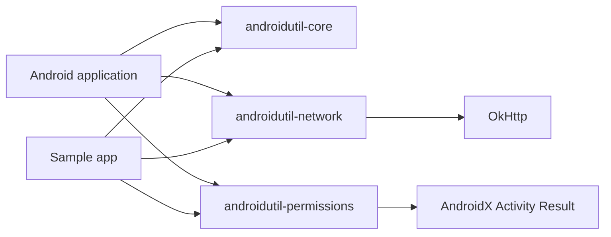

# Architecture and scope

AndroidUtil is intentionally modular. Applications should depend only on the capabilities they use.

## Design rules

1. Public APIs are Kotlin-first and straightforward from Java.
2. Modules do not depend on each other unless the capability requires it.
3. UI ownership remains with the host application.
4. Context references use the application context and are never retained unnecessarily.
5. Files are private by default; restricted hardware identifiers and hidden Android APIs are out of scope.
6. Network clients are injectable, calls are cancellable, and logging is opt-in and redacted.
7. A utility must be smaller and clearer than asking consumers to adopt a dedicated library.

The project will reject image loaders, payment wrappers, analytics, dependency injection frameworks, and broad UI component collections. Established libraries and vendor SDKs solve those jobs better.
